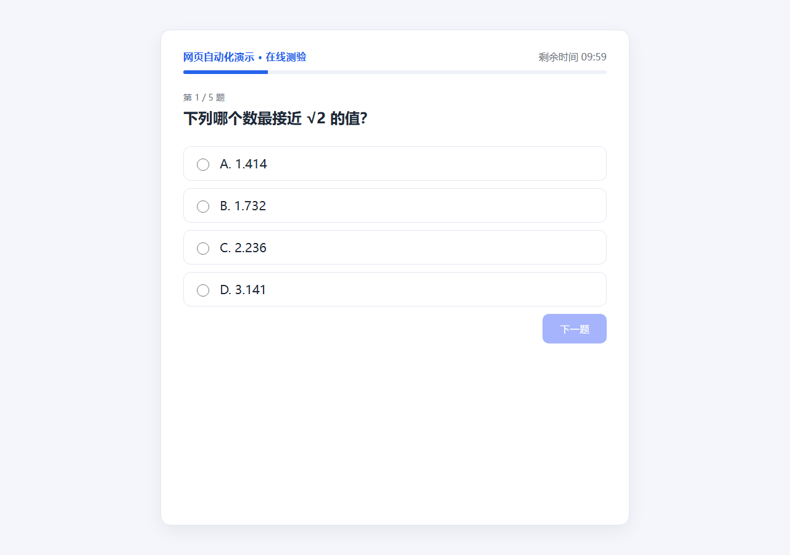

# webagent

> 用**任意 OpenAI 兼容大模型**驱动网页自动操作：截图 → 识别 → 模型决策 → 鼠标键盘执行 → 复检，循环直到完成。



<p>
  
  
  
</p>

一个跑在 Windows 上的「桌面级 GUI Agent」：它不依赖浏览器插件、不改网页、不注入脚本，
而是像人一样**看屏幕、动鼠标**。因此对任何网页都适用——包括公司内网系统、老式后台、
没有 API 的第三方站点。

---

## 目录

- [它是什么](#它是什么)
- [核心特性](#核心特性)
- [完整流程](#完整流程)
- [快速开始](#快速开始)
- [配置说明](#配置说明)
- [支持的模型](#支持的模型)
- [命令参考](#命令参考)
- [模型输出协议](#模型输出协议)
- [工程细节](#工程细节)
- [项目结构](#项目结构)
- [开发与测试](#开发与测试)
- [常见问题](#常见问题)
- [已知限制](#已知限制)
- [使用边界](#使用边界)
- [English](#english)
- [License](#license)

## 它是什么

给一句话任务，例如：

> 「这是在线答题页面，选出正确答案并点击；填空题填写答案；完成后点下一题。」

`webagent` 会反复执行：

```
截图 → OCR/图像 → 发给大模型 → 收到 JSON 动作计划 → 执行 → 再截图复检 → 继续
```

它适合：网页自动化测试、无障碍辅助、把没有 API 的重复网页操作自动化、GUI Agent 研究。

## 核心特性

- **模型无关**：任何兼容 `POST /chat/completions` 的服务都能用（DeepSeek / OpenAI /
  Moonshot / 通义 / Groq / Ollama 本地模型……），只改 `base_url` + `api_key` + `model`。
- **视觉 / 文本双通道**：视觉模型直接看图；纯文本模型用 OCR 文字 + 归一化坐标定位。
- **零重型依赖**：截图用 GDI、键鼠用 `SendInput`、OCR 用 Windows 内置引擎、
  模型调用用标准库 `urllib`。唯一第三方依赖是 Pillow（画图/编码 PNG）。
- **安全默认**：默认 `dry-run`，只让模型规划、不点击；必须显式 `--live` 才动手。
- **抗死循环**：动作后对比页面指纹，没变化就警告模型换动作，连续多次无变化自动停止。
- **可观测**：每步打印模型计划，截图落盘到 `debug/`，方便回溯。

## 完整流程

```
┌─────────────┐   ① 按标题找到窗口（DPI 感知，最小化自动还原）
│  浏览器窗口  │   ② GDI BitBlt 截取客户区（物理像素）
└──────┬──────┘
       │ ③ Windows OCR → 词 + 坐标 → 按行/段聚合
       ▼
┌───────────────────────────────────────────────┐
│ 组装上下文                                     │
│  · 任务指令（agent.instruction）                │
│  · 当前状态（已选 C / 已填 北京）                │
│  · 可交互元素（选项/按钮/输入框 + 精确 bbox）     │
│  · 可见文本（每行附归一化坐标）                   │
└──────┬────────────────────────────────────────┘
       │ ④ 调模型（文本 or 图+文）
       ▼
┌───────────────────────────────────────────────┐
│ JSON 动作计划                                   │
│ {"done":false,"actions":[                      │
│   {"type":"click","bbox":[x1,y1,x2,y2]},       │
│   {"type":"type","bbox":[…],"text":"北京"}]}    │
└──────┬────────────────────────────────────────┘
       │ ⑤ 归一化坐标 × 窗口尺寸 → 物理像素 → 点击/粘贴
       ▼
┌───────────────────────────────────────────────┐
│ ⑥ 复检：重新截图对比指纹                        │
│  · 页面变了 → 继续下一步                        │
│  · 页面没变 → 提示模型「换动作」，连续 3 次则停止  │
│  · 有输入动作 → 校验文字是否真的出现在页面上       │
└──────┬────────────────────────────────────────┘
       │ done=true 或达到 max_steps
       ▼
     结束，输出 result
```

## 快速开始

### 1. 准备

- Windows 10/11
- Python 3.9+
- 一个 OpenAI 兼容服务的 API key

```bash
git clone https://github.com/<your-name>/webagent.git
cd webagent
python -m pip install -r requirements.txt
copy config.example.json config.json
```

### 2. 填 API key

```bash
python -m webagent key
# 提示时粘贴你的 key，回车
```

或设置环境变量：`set DEEPSEEK_API_KEY=sk-xxx`

### 3. 打开目标网页

用浏览器打开要操作的页面，然后确认能定位到窗口：

```bash
python -m webagent windows          # 列出所有窗口标题
python -m webagent doctor           # 检查「目标窗口」是否显示“找到”
```

如果标题不对，改 `config.json` 里的 `target.window_title`（子串匹配即可）。

### 4. 先预览，再执行

```bash
python -m webagent run --dry-run    # 只让模型规划，不点击
python -m webagent run --live       # 真正执行
python -m webagent watch --live     # 持续循环（F8 暂停/继续，F9 立即一次，Esc 退出）
```

Windows 上也可以直接用 `run.bat run --live`（会自动寻找带 Pillow 的 Python）。

### 试一试

内置了一个可离线测试的示例网页：

```bash
python -m webagent demo             # 浏览器打开 demo/quiz.html（标题“在线测验”）
python -m webagent run --mock-live --force   # 不联网，验证“截图→定位→点击”链路
```

## 配置说明

`config.json`（从 `config.example.json` 复制）：

| 字段 | 说明 | 默认 |
| --- | --- | --- |
| `target.window_title` | 浏览器标签页标题（=网页 `<title>`），子串匹配 | `在线测验` |
| `target.window_match` | `contains` / `regex` / `exact` | `contains` |
| `target.client_area` | 只截网页视口，不含浏览器边框 | `true` |
| `target.activate` | 操作前把窗口切到前台 | `true` |
| `model.base_url` | OpenAI 兼容接口地址 | DeepSeek |
| `model.api_key` | API key（留空则读环境变量） | `""` |
| `model.api_key_env` | 从哪个环境变量读 key | `DEEPSEEK_API_KEY` |
| `model.model` | 模型名 | `deepseek-chat` |
| `model.vision` | 模型是否支持图片输入 | `false` |
| `model.mock` | 不联网，用脚本化计划自检 | `false` |
| `ocr.enabled` | 是否做 OCR（文本模型必须开） | `true` |
| `ocr.language` | Windows OCR 语言标签 | `zh-Hans` |
| `ocr.scale` | OCR 前放大倍数，小字可调 1.5~2 | `1.0` |
| `agent.instruction` | 任务指令，留空用内置默认（答选择题/填空题） | `""` |
| `agent.max_steps` | 单轮最多动作步数 | `20` |
| `agent.step_delay_s` | 每步之间的等待 | `0.5` |
| `agent.cooldown_s` | 同一页面状态多久内不重复执行 | `2.0` |
| `action.type_mode` | `paste`（剪贴板，中文可靠）/ `unicode` | `paste` |
| `action.click_delay_ms` | 点击后等待 | `120` |
| `runtime.interval_s` | watch 模式采样间隔 | `2.0` |
| `runtime.debug_dir` | 截图落盘目录 | `debug` |

## 支持的模型

| 服务商 | `base_url` | `model` | `vision` |
| --- | --- | --- | --- |
| DeepSeek | `https://api.deepseek.com/v1` | `deepseek-chat` | false |
| OpenAI | `https://api.openai.com/v1` | `gpt-4o-mini` | true |
| Moonshot | `https://api.moonshot.cn/v1` | `moonshot-v1-8k` | false |
| 通义千问 | `https://dashscope.aliyuncs.com/compatible-mode/v1` | `qwen-plus` / `qwen-vl-max` | vl 系列 true |
| Groq | `https://api.groq.com/openai/v1` | `llama-3.3-70b-versatile` | false |
| Ollama 本地 | `http://localhost:11434/v1` | `qwen2.5` / `llama3.2-vision` | 视模型 |

> 纯文本模型也能用：OCR 会把「文本 + 归一化 bbox」一并交给模型，模型直接引用 bbox 点击。

## 命令参考

| 命令 | 作用 |
| --- | --- |
| `python -m webagent init` | 生成默认 `config.json` |
| `python -m webagent key [KEY]` | 写入 API key（免手工编辑） |
| `python -m webagent doctor` | 环境自检（Python/Pillow/屏幕/窗口/OCR/模型） |
| `python -m webagent windows` | 列出可定位的窗口标题（含最小化窗口） |
| `python -m webagent snapshot --lines` | 截图 + OCR 预览，排查识别问题 |
| `python -m webagent demo` | 打开内置示例网页 |
| `python -m webagent run [--live] [--dry-run] [--mock] [--force] [--instruction ...]` | 执行一轮 |
| `python -m webagent watch [--live]` | 持续循环 + 全局热键 |

## 模型输出协议

模型必须只返回一个 JSON 对象（程序会容忍 markdown 围栏、前后废话）：

```json
{
  "done": false,
  "reasoning": "第1题答案为A，点击选项A",
  "actions": [
    {"type": "click", "bbox": [0.295, 0.447, 0.350, 0.467], "reason": "选项A"}
  ],
  "result": null
}
```

- `bbox`：`[x1,y1,x2,y2]`，相对整张截图归一化到 `0~1`。
- 动作类型：`click` / `type` / `scroll` / `key` / `wait`。
- `done=true` 时把结论写进 `result`。

## 工程细节

这些是实现过程中踩过的坑，也是代码里最值得看的部分：

1. **DPI 一致性**：进程启动即声明 Per-Monitor DPI 感知，保证
   `GetWindowRect`、GDI 截图、`SetCursorPos` 用同一套物理像素坐标，否则 150% 缩放下点击必偏。
2. **OCR 表达不了“选中状态”**：单选按钮的实心/空心在文本里看不出来，模型会反复点同一个选项。
   所以额外做「页面状态推断」（`已选 C` / `已填 北京`），并明确告诉模型该去点「下一题」。
3. **合并行会导致点空**：`已选 C 下一题` 若合成一个大 bbox，中心落在空白处。改为**按文本段**
   分别给 bbox，点「下一题」才精准。
4. **64 位句柄截断**：`GlobalAlloc/GlobalLock` 若按默认 `c_int` 返回会被截断，写剪贴板直接崩溃。
   必须显式声明 `c_void_p` 返回类型——这是中文输入一直失败的根因。
5. **无变化自检**：动作执行后对比页面指纹，没变化就提示模型换动作，避免「一直点同一个地方」。
6. **最小化窗口**：`GetWindowRect` 对最小化窗口返回 `-21333`，改用 `GetWindowPlacement` 取恢复位置。

## 项目结构

```
webagent/
├── webagent/
│   ├── __main__.py     # CLI（init/doctor/key/windows/snapshot/run/watch/demo）
│   ├── agent.py        # 核心：上下文组装、模型调用、计划解析、执行与自检
│   ├── capture.py      # GDI 截图、窗口定位、DPI 感知
│   ├── ocr.py          # Windows OCR 封装（PowerShell WinRT 投影）
│   ├── ps_ocr.ps1      # OCR 的实际执行脚本
│   ├── models.py       # OpenAI 兼容客户端（urllib，支持 vision）
│   ├── actions.py      # 鼠标/键盘/滚轮/剪贴板（SendInput）
│   ├── hotkeys.py      # 全局热键轮询
│   └── config.py       # JSON 配置加载与合并
├── demo/quiz.html      # 内置示例网页（可离线测试）
├── tools/mock_server.py# 本地假模型服务，离线验证模型链路
├── tests/              # 单元测试
├── docs/demo.png       # 演示截图
├── config.example.json # 配置模板（不含密钥）
├── run.bat             # Windows 启动器
└── pyproject.toml
```

## 开发与测试

```bash
python -m unittest discover -s tests -v
```

不联网即可测试模型链路（本地假服务）：

```bash
python tools/mock_server.py --port 8799 --plan-file tools/plan.json --log tools/requests.jsonl
python -m webagent run --config tools/test_config.json --dry-run
```

## 常见问题

**提示“未找到窗口”**：先打开网页，再 `python -m webagent windows`，把 `target.window_title`
改成标题里的关键片段。

**点击位置偏移**：确认浏览器和程序在同一显示器、同一缩放；程序已自动处理 DPI。

**OCR 识别不到文字**：中文需要系统安装中文 OCR 语言包（`doctor` 会显示 OCR 状态）；
小字可把 `ocr.scale` 调到 1.5。

**模型反复点同一个选项**：确认 `agent.max_steps` 足够；程序会把“已选 X”作为状态提示，
若模型仍不听，换更遵循指令的模型或降低 `temperature`。

**输入中文没反应**：保持 `action.type_mode = "paste"`；若目标程序禁用粘贴，改 `"unicode"`。

**模型返回非 JSON**：程序会自动剥离代码块并截取 `{...}`；仍失败就把 `temperature` 调 0。

## 已知限制

- 仅支持 Windows（依赖 GDI / SendInput / Windows OCR）。
- 坐标定位依赖 OCR 与模型，文字遮挡、动态弹窗、复杂 Canvas 场景可能不准。
- 一次只操作一个窗口，不支持多标签页切换。
- 每个动作都要调一次模型，速度受模型延迟影响（约 1~3 秒/步）。

## 使用边界

本项目是**通用网页自动化框架**，忠实执行你在 `agent.instruction` 中描述的任务。请仅在
**你有权限、且不违反目标平台规则或考试纪律**的页面上使用；不要用于绕过监考、代考、
刷单或任何违法用途。API key 由你自行保管，泄露风险自负。

## English

**webagent** is a Windows GUI agent that automates any web page by *looking at the screen*:
it captures the browser window with GDI, reads text via Windows OCR (and optionally the
image itself), asks any OpenAI-compatible model for a JSON action plan, then performs real
mouse clicks and keyboard input — with a page-fingerprint check after every step to avoid
loops.

- Model-agnostic (`base_url` + `api_key` + `model`)
- Vision or text-only models
- Safe by default (`--dry-run`)
- No browser extension, no JS injection, works on any web UI

```bash
pip install -r requirements.txt
copy config.example.json config.json
python -m webagent key          # paste your API key
python -m webagent run --live
```

## License

[MIT](LICENSE)
